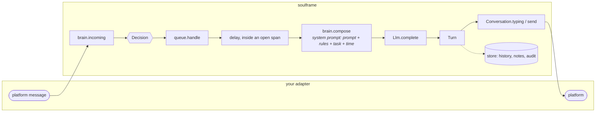

# Concepts

soulframe runs AI personas of any kind: characters that keep hours, remember the people they talk with and answer at
a human pace. This page explains the pieces and how they fit. The keys are in [configuration](./configuration.md), the
signatures in the [API reference](./api.md).

In words: your adapter hands each platform message to `brain.incoming`, which answers a `Decision` at once.
`queue.handle` waits for a human-paced delay inside an open span, then `brain.compose` builds the system prompt and
calls the model (`Llm.complete`). The resulting `Turn` is typed and sent through your `Conversation`, and the history,
notes and audit go to the store.

## Persona

A persona is two things: its **config**, the data the code computes with, and its **prompt**, free Markdown: who it
is, how it talks, what it knows. `parsePersona({ config, prompt, channels })` checks the two from wherever the
application keeps them; the one file format the package reads, a Markdown file per persona with its config as YAML
frontmatter, is optional (`loadPersonas`, `parsePersonaMarkdown`). A loaded persona is a `Persona`:

| Field | What it is |
| --- | --- |
| `id` | 2 to 32 of `a-z`, `0-9` and `-` (`PERSONA_ID`): the key of everything stored about it and the seed of its days; a persona file's name. |
| `name` | The name it goes by, 1 to 32 characters. |
| `timezone` | An IANA time zone; its hours are local to it. |
| `schedule` | Its hours by weekday. |
| `moods` | The moods it draws one of each day, by weight. |
| `prompt` | Its voice and background, trimmed. |

Nothing else: what it says is its prompt's, and how its brain runs (models, limits, memory, pacing, the typed checks)
is the brain's **settings** (`createBrain({ persona, settings })`, read with `parseSettings`), never the persona's.
One settings object may serve every persona, or a persona's brain may get its own.

The **system prompt** of every task is assembled in this order, so what comes later wins:

1. the persona's own prompt;
2. the identity line: its name, your phrase on what it is (`createBrain({ identity })`) and where it is talking
   (`Channel.where`), then the channel's `identityNote` when there is one;
3. your style block, if any (`createBrain({ style })`): how your personas write. soulframe has no voice of its own;
4. the rules, if any (see [Safeguards and policy](#safeguards-and-policy)): the 18+ line on an adult channel, the
   `sfw` line of a safe-for-work policy (`policy.sfw`), then your `policy.rules`;
5. the task (a DM turn, a group-chat line or a post) with its answer format and the model's notes. A DM turn and a
   group-chat line end with the time line: the time and the persona's day. A post has no time line. What changes on
   every call goes last, so a provider's prompt cache can reuse the rest.

The **mood** of the day is picked from its `moods` by weight, seeded by the persona and the agenda day, so it
holds through a night past midnight and after a restart. It ends the time line ("Your mood today: ..."), and, when
the prompt has rules, says it never changes them.

## Agenda: spans, busy blocks and the situation

A persona's hours are written as a `schedule` by weekday (the same hours every day are one block under `mon-sun`). Each block gives
ranges, `[earliest, latest]` as local `"HH:MM"`, and an exact time is drawn in each range every day. For each local
date the hours become an **agenda**:

- **Spans**: when it is online. A span is `{ kind, start, end, on?, day }` in milliseconds.
  - `online`: full online time. Everything is allowed: DMs at any pace, group chats, posts, joining a group chat.
  - `break`: a few minutes between busy times. DMs only, quick replies only; a group-chat invitation waits for full
    online time.
- **Busy blocks**: offline time with a reason that completes "you're ..." ("at work", "at the gym"). They are drawn on
  skipped days too: work happens on days it does not come online.
- **Skipped days**: `skipDayChance` is the chance of a day with no online time at all; each block also has its own
  `chance` of happening that day.

The draw is seeded by the persona id and the date, so a restart draws the same day. A block belongs to the day whose
plan made it, past midnight too, and daylight saving changes are handled (a time a spring-forward jump skips maps to
the moment of the jump).

A span may be limited to some channels with `on:` (a list of `ChannelId`s); left out, it counts on every channel the
persona has. `spanAt(persona, at, channel?)` answers the span open at a moment, `fullyOnline(persona, channel, at)`
whether it is a full `online` span, and `watchSpans` calls you back whenever the span on a channel changes.

While a span is open, the brain tells the model its **situation**, each part behind a `settings.context` toggle:

- what it is doing now: free and online until about a time, or on a short break from a busy block;
- what comes next: back to that busy block, the next busy block within 36 hours, when it will be online again;
- in a DM, that the person's messages came in while it was offline (and where it was);
- in a DM near the end of a span (the last 10 minutes, or the last third of a shorter span), a nudge to wrap up and
  say bye rather than vanish.

Times are rounded to 5 minutes ("until about 12:50 PM"): its day is only roughly planned. Outside its spans the
reply queue keeps replies in the backlog; only the code's goodbyes (see [Safeguards and policy](#safeguards-and-policy))
go out at any time.

## Channels

soulframe never knows a platform. An application describes each place a conversation happens:

- **`ChannelId`**: an opaque string the application chooses (`'console'`, `'chat'`, `'forum'`). It keys the persona's
  hours (`on:`), its contacts' identities, the deny list and the minor flags.
- **`Channel`**: `{ id, where, maxLength, targetLength?, identityNote?, notes?, invitations?, actions?, adult? }`.
  `where` completes "chatting by text in ..."; `maxLength` is the longest message sent there (a longer one is cut at a
  word); `targetLength` the soft length a group-chat line there is asked to stay under (150, or four fifths of
  `maxLength` when that is less);
  `invitations` lets a DM turn answer group-chat invitations; `actions` are what a DM turn may do there besides
  talking and blocking (each a `name` and `when` to choose it). Blocking is always offered. Channels may add a
  disclosure note (`Channel.identityNote`), and `notes` on the place for the model's group-chat and post tasks there
  ("everyone here is planning a trip together"). `adult: true` marks the conversations there as 18+ and turns on the
  minors safeguard (see [Safeguards and policy](#safeguards-and-policy)).
- **`Conversation`**: what an adapter implements for one person on one channel: `channel`, `typing(on)`,
  `send(text)`, and optionally `typingRefreshMs`, `markRead()`, `delivered(text)`, `extraLines(person)` and
  `invitation`. See [channels](./channels.md).

One persona can be on several channels at once, each with its own `Channel` (a DM surface, a group chat, a posting
channel), all sharing one brain, one reply queue and one memory.

## The reply queue and the backlog

Every setting below is explained in plain terms in [attention, timing and relationships](./attention.md).

`brain.incoming` decides at once what a message calls for; the **reply queue** (`createReplyQueue`) decides when and
delivers:

- **One person at a time.** While it writes or sends a reply to someone, it starts nobody else's: turns that came due
  wait, and the first to come due starts the moment it is free, with no polling. What a turn learns about the persona
  itself (its self notes, read when a turn starts and stored when it ends) is never overwritten by a turn that began
  earlier. A turn under way for over 10 minutes stops holding the others back, so a send that never returns cannot
  silence the persona.
- **Who goes first.** When several turns are due while it is busy, the next is drawn at random by weight
  (`pacing.priority`): how close it is to them (familiarity, affinity), how much their conversation matters now (its
  importance, fading back to an ordinary chat's), up to three times as much while it still watches their chat, and
  more the longer they waited, so nobody waits forever (`reply_picked`). With the typed checks on, how much their new
  messages matter is asked as their turn comes due (`brain.assess`, `decisions.importance`), so a confession can go
  ahead of a "hey, what's up" before the model has read either. `weighted: false` takes them in the order they came due.
- **One turn per person at a time.** More messages from them while a turn waits are answered together
  (`reply_batched`).
- **Bursts.** A turn starts only once they stopped writing: `pacing.burst.settleSeconds` of quiet after their newest
  message, each message starting the wait again, up to `maxSettleResets` times. A message that comes in while the reply
  is being written, before its first message is sent, drops the draft (`reply_superseded`, then `reply_restarted`): it
  is written again, with that message read, once they are quiet (`restartOnNewMessage`, at most `maxRestarts` times in
  a row). Nothing of a dropped draft is sent or stored: a turn's notes, block or action are kept only with the turn
  (`Turn.keep`). Too late for that (something was sent already, or the restarts are spent), the message gets a turn of
  its own once this one ends (`reply_after_turn`).
- **Inside an open span**, a turn is timed by what the persona is doing. While it writes a reply to anyone, and for a
  while after, it is on its phone (`pacing.watching`: the chance starts at 1 and halves every 90 seconds by default),
  and a new message from anyone is noticed after a short lag: a live conversation with one person doesn't leave
  another waiting for its next glance (they still wait for the reply under way, one person at a time). Otherwise it
  notices a message when it next looks at its messages, one look for everyone: whoever wrote before it is noticed
  then, together, and picked among by weight; and once it picks up its phone for someone's turn it notices whatever
  else was waiting (`pacing.glance`: skewed like
  real answer times, around a median of 40 seconds by default, a few taking minutes). On a `break` it is on its phone: only the short lag. A turn is always due at least
  90 seconds before its span ends.
- **Interruptions.** Now and then while online, something takes it away from its messages for a few minutes
  (`pacing.interruptions`, drawn per day from a seed, like the agenda; `personaReport` lists today's). No turn starts
  until it is back, a reply it was typing is finished first, and it watches no chat when it comes back. One that comes
  in the middle of a conversation that matters (its importance at `holdAtImportance` or more, an exchange within
  `calmMinutes`, or a turn of theirs coming) is held off and taken once that conversation calms down
  (`interruption_held`); the end of its online time is its agenda's and comes regardless. Being busy with others
  needs no roll of its own: their turns, one at a time, are what keeps someone waiting.
- **Otherwise it waits in the backlog.** When a span opens on its channel, the backlog is answered one person at a
  time, oldest first, with `backlogGapSeconds` before each (and `returnOnlineReplyDelayMinutes` more before the first
  one of a span).
- **Delivery** types before each message for a time proportional to its length (`typingCharsPerSecond`, within
  `typingDurationSeconds`, each persona's own), pauses between the messages of one reply, and splits a long single
  reply in two now and then (`replySplitChance`). The model may also write up to three messages itself, one per line.
  Each of these values is drawn from its range with a shape that fits it: speeds on a bell curve around the middle,
  waits and pauses skewed like the time people take (see [configuration](./configuration.md#settings)).
  While the model writes the reply, it reads what they wrote, as long as that takes at its reading speed
  (`readingCharsPerSecond`, `readingDurationSeconds`, then `looking` per photo); typing starts once both are done. Three opt-in touches make it
  look closer to a person typing: the conversation's `typingRefreshMs` keeps the
  indicator on while a long message is typed (platforms drop it after a few seconds), its `markRead()` shows their
  messages read as it starts writing the reply, and `thinkingPauses` lets typing
  stop a moment and start again in a long message. The halt switch, `stop()` and the person's state are checked after
  every wait, and typing never stays on after a reply is cut short or fails.
- **Restarts.** While running (`queue.start()`), the queue records every 30 seconds when the persona was last online.
  After a restart, `queue.requeue(channel, conversationOf)` puts everyone still owed a turn since then (up to 48 hours
  before it) back into the backlog.
- **Failures.** A model call that fails is tried again after `retries.delayMinutes` times the attempt number, up to
  `retries.attempts`; a spent token budget waits `retries.budgetCheckMinutes` between checks and counts no attempt;
  a provider outage doubles the wait after each try, up to 16 times; a task with no provider or model set is not
  tried again at all (only new settings mend it), and the person stays owed for the next start. A failed `send` is
  never retried (it may have landed); the rest of that reply is dropped.
- **Halt and dry run.** `Runtime.halted()` (the halt file exists) stops everything from being sent or started: turns
  go back to the backlog. With `Runtime.dryRun`, messages are logged instead of sent, actions and joins are logged
  instead of carried out, and nothing is marked handled.

A turn's messages are recorded in the history only once actually sent, and the person's messages are marked handled
once delivery was attempted.

## Memory and identities

The store (`createStore` on a database from `openDatabase`) keeps everything in one SQLite file, through Node's
built-in `node:sqlite`. Its tables are made, if missing, each time it opens. The application may keep its own tables
in the same database (and migrate its own older layouts before the store opens; `inTransaction` helps).
`node:sqlite` is still marked experimental in Node 22, so Node may print an `ExperimentalWarning` once, when soulframe
loads; `node --disable-warning=ExperimentalWarning` hides it.

- **People.** A person belongs to one persona: two personas talking with the same account have two people. A person
  has a `state` (`active`, `stopped` when they asked to stop or cannot be reached, `blocked` by the persona, `denied`
  when deny-listed), counts (`incoming` messages, `conversations`) and times (`lastInAt`, `handledAt`, `firstSeenAt`).
- **Identities.** A person has at most one account per channel, in `Person.ids` (`{ [channelId]: externalId }`).
  `brain.incoming` creates the person on a first message; `store.link` attaches an account on another channel, so the
  history, notes and relationship follow them across channels.
- **Messages.** The history, both directions, across channels. Only the newest `memory.historyMessages` are sent with
  each turn: the notes carry what matters from older ones. A photo is kept as its description and a link as its
  preview card ([attention](./attention.md#perception-photos-and-links)).
- **Notes.** The model rewrites, at most each turn, its notes on the person (`Person.summary`, up to
  `memory.personNotes` characters) and on itself (made-up details it must keep consistent, up to `memory.selfNotes`,
  shared by all its conversations).
- **Relationship.** Two numbers per person, in the store. **Familiarity** (0 to 1) is counted by the code, never set
  by the model: each turn the reply queue keeps adds to it, more when the conversation mattered (the turn's
  `importance`, 0 to 3, which the model rates), and it fades while they are apart. **Affinity** (-1 to 1) is moved one
  small step per turn as the model answers (warmer, cooler, or no change), never set outright; it can be turned off.
  The DM prompt describes both as levels, shipped as seven and five sentences in `prompts.ts` and replaceable,
  thresholds and words (`settings.relationship`). The levels are set once per conversation (a message
  after `memory.conversationGapHours` of silence starts one), go back down only past a margin, and come with the way
  things went lately ("You've grown closer lately."), so the tone changes a step at a time, between conversations.
  Both also weigh who it answers first (below).
- **Deny list.** Shared by every persona and keyed by channel and account: someone deny-listed by one persona is never
  approached by another, and every person with that account is denied at once.
- **Minor flags**, **kv** (small per-persona values, token counts) and the **audit** log (what was decided, with the
  probabilities of any typed checks). `store.sweep(before)` deletes old messages and audit lines.

## The brain

`createBrain` gives a persona its brain, with three capabilities:

1. **Direct messages.** `incoming(channel, externalId, name, message, at?)` (`channel`: the `Channel`; `message`: their words, or an
   `IncomingMessage` with photos and links) is synchronous: it
   records the message, runs the code's own checks and answers a `Decision`: `ignore` (denied, stopped, blocked), `final` (the code's
   goodbye: the conversation is over) or `reply` (answer later). `compose(personId, channel, options?)` writes the
   turn: up to three messages or none (left on read), the rewritten notes, an action (`none`, one of the
   channel's `actions` there, `block`) and, where the channel takes invitations, whether to accept one. The queue calls it for you.
2. **Group chats.** `composeGroupChatLine(chat, recent, quiet, hosted)` reads the recent lines (`GroupChatLine[]`)
   and answers one short line, or `null` to stay quiet. How much it talks there is its prompt's to say, and
   the channel's `notes` are listed with its instructions. `wantsToSpeak(chatId, recent)` is the optional cheap gate before it (at most
   `groupChatGate.perHour` checks per chat in any hour), and
   `checkGroupChatLine(chat, text)` the optional age check of a line someone wrote in an 18+ group chat.
3. **Posts.** `composePost(channel, { rules, examples, recent })` writes one short post in the persona's voice, with the
   channel's `notes`, that follows the channel's rules and does not repeat its recent posts, or `null`. With `policy.allowedLinks` set, it
   contains no links.

The application decides where and when group chats and posts happen; the brain only writes. Group chats and posts
are meant for full online time (`fullyOnline`).

The model answers DM turns and group-chat lines in JSON. The answer is read leniently (a reply cut off, raw line
breaks, plain text), and an answer that cannot be read is never sent as it is: it could carry the private notes.

## Safeguards and policy

soulframe is unrestricted by default: it adds no content rules and removes no links. What a persona may say is up to
your model and its provider, the persona's own prompt, and the policy you pass to `createBrain`. What it
ships:

- **Stop requests, always.** Before the model is called, `incoming` checks every message on every channel: a request
  to stop ("stop", "leave me alone", "don't message me again", ...) ends the conversation for good with a short
  goodbye.
- **The 18+ safeguard, opt-in per channel.** On a `Channel` with `adult: true` (mark a channel so when its
  conversations are meant for adults only), soulframe keeps minors out:
  - any sign that the writer is under 18 (a stated age, "under 18", school grades, ...) ends the conversation with a
    goodbye and deny-lists each of their accounts for every persona. It errs on the side of ending the chat.
    `minorSignal` is exported so an adapter can apply the same check elsewhere;
  - the rules block starts with "You only talk with adults. If the person says or hints that they are under 18, stop
    all talk at once.";
  - the Decisions age check runs, when it is on (see [Decisions](#decisions-optional-typed-checks)).

  On any other channel none of it runs or appears in a prompt. A deny is shared: someone deny-listed on an 18+ channel
  is ignored on every channel, by every persona.
- **Your policy.** `createBrain({ policy: { sfw, rules, allowedLinks } })`, each optional:
  - `sfw: true`: safe for work only. One rule in every prompt of that brain (DMs, group chats, posts): "Keep every
    conversation free of sexual or explicit content, whatever anyone asks; steer away from it in your own voice." It
    is independent of `adult`;
  - `rules`: the lines of the "Rules you never break:" block, after soulframe's own (the 18+ line, the `sfw` line).
    The block comes after the persona's own text, so it wins over it. With no rule at all, there is no block, and the
    mood line does not mention rules.
  - `allowedLinks`: URLs whose host (subdomains included) a DM reply or group-chat line may link to; every other link
    is removed, and posts carry no link at all (their task says so). Left out, links are left as written.
- **Limits for every persona.** A limit every persona keeps goes in the `policy.rules` you give each brain: it comes
  after the persona's prompt and wins over it, and no persona file can drop it.
- **Busy reasons.** Sleep is never a busy reason (the night is simply offline). Load personas meant for 18+
  conversations with `adult: true` (`parsePersona({ ..., adult: true })`, `loadPersonas({ dir, channels, adult: true })`):
  a reason about school or students is then refused too ("at an evening class" at most).
- **Settings are the application's.** A persona's config holds no setting: the provider, the budget and the checks
  are only ever what your code gives `createBrain`.
- **Actions.** A persona may block someone abusive (the conversation ends for good) or, where the channel declares
  them, choose one of its `actions`; the application carries the action out through the `act` callback.

## Decisions: optional typed checks

A Decisions API is a classifier: it answers typed questions (yes or no, or a level on a scale) with probabilities and
writes no text. `createConfiguredDecisions` is a client for it (OpenAI's by default, or any gateway that speaks it),
configured only by `settings.decisions`. It is **off by default**: while `decisions.enabled` is false nothing is sent.

When it is on, it adds three checks:

- **Age**, on 18+ channels only (`Channel.adult`): of the person's new DM messages and, optionally, of each group-chat
  line. In a DM turn, at `minor.denyAt` it acts like the code's own check (goodbye, deny list); at `minor.cautionAt`
  it only flags the person for every persona, and their DM prompt on an 18+ channel then rules out any sexual or
  suggestive talk with them, lets the persona ask their age, and says the adults-only rule applies (stop) if they say
  or hint they are under 18. For a group-chat line,
  `brain.checkGroupChatLine` answers the level (`deny`, `caution` or `none`) and the adapter acts on it: a line at
  `caution` or above is meant never to be answered in that group chat.
- **Stop**: asking not to be messaged, however it is worded, at `stop.at`.
- **Group-chat gate**: whether the newest lines are addressed to the persona, and how natural it would be to chime in,
  compared with its brain's threshold (`groupChatGate.chimeInAt`), before the group-chat model is called.

It is additive only. The code's own checks run first and stay authoritative; every failure, timeout, refusal or spent
budget (`decisions.dailyTokens`, counted apart from text generation) behaves exactly as if it were off. The thresholds
are not calibrated: tune them from the audit rows, which record each probability.

## Errors

Where things can go wrong, and how each one reaches you:

- **Config.** `parsePersona`, `parsePersonaMarkdown`, `loadPersonas` and `parseSettings` never throw on a config
  problem: every problem is in `issues`, with its source and path, and a persona (or settings) with one is not given
  (see [configuration](./configuration.md#errors-and-warnings)).
  Throw a `ConfigError` yourself to stop on them.
- **No provider.** `llmsFor` throws, naming every persona without one, outside a dry run. A task left without a
  provider or a model rejects with a configuration error that the queue never retries (`reply_given_up`).
- **The model.** A rejection from `Llm.complete`, or an answer `compose` cannot read, is a failed attempt: the queue
  retries it (`settings.retries`). A spent token budget or a provider outage waits without counting an attempt.
- **Delivery.** `Conversation.send` rejects with an `UnreachableError` when the person can't be reached any more
  (they become `stopped`), or with any other error (`delivery_failed`; never retried). A rejection from `typing`,
  `markRead` or `delivered` counts as a failed delivery. See [channels](./channels.md#typing-and-send).
- **Decisions.** The client never throws: a failure, a timeout or a spent budget behaves as if the checks were off.
- **The store.** `personById` throws when there is no such person, and `link` when the account is already taken:
  check with `person` first.

`queue.handle` resolves once the decision is acted on; catch its rejection in your adapter and log it.

## Context toggles

`settings.context` turns parts of the prompt off without changing anything else (hours, presence and pacing stay as
they are):

| Toggle | What the model is told |
| --- | --- |
| `situation` | What it is doing now, and near the end of a span in a DM, the wrap-up. |
| `upcoming` | What comes next, and when it will be online again. |
| `awayContext` | In DMs, that their messages came in while it was offline. |
| `relationship` | In DMs, how well it knows the person. |
| `timeSince` | How long since each side wrote in DMs, and since the last line in a group chat. |
